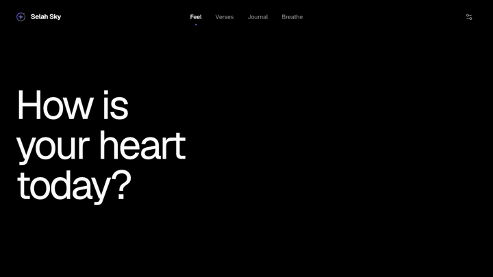
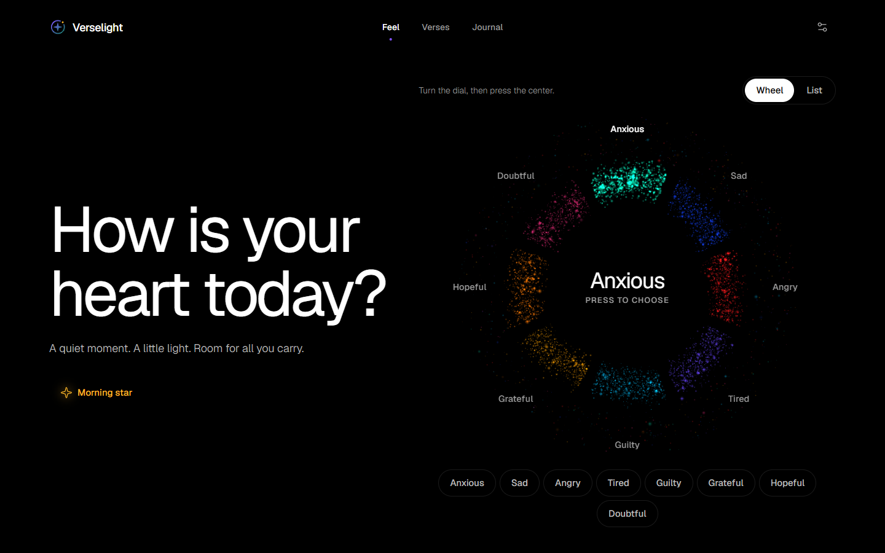
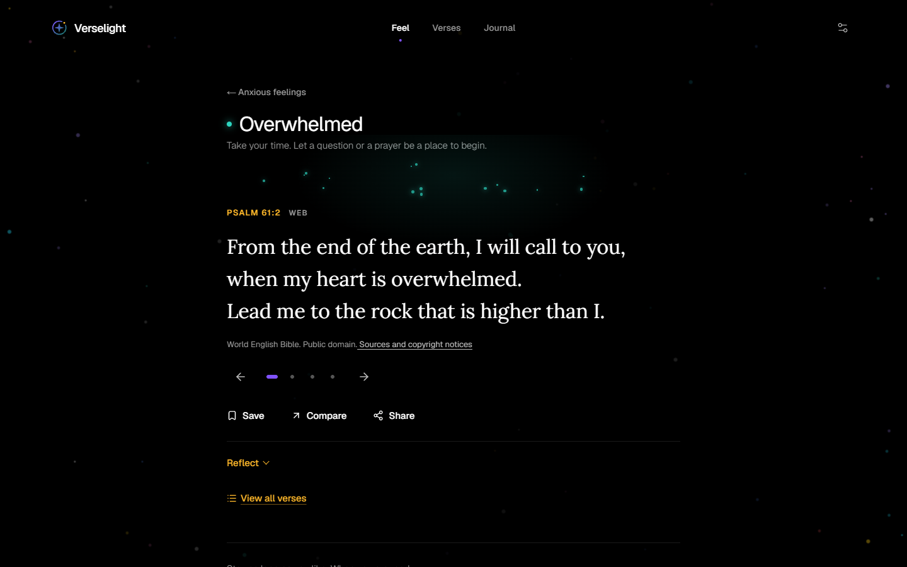
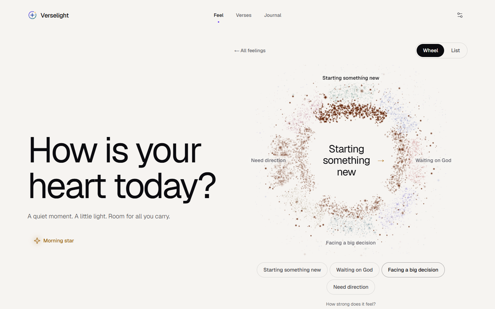
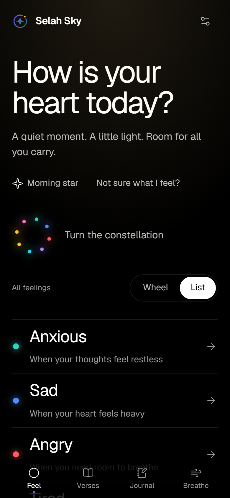
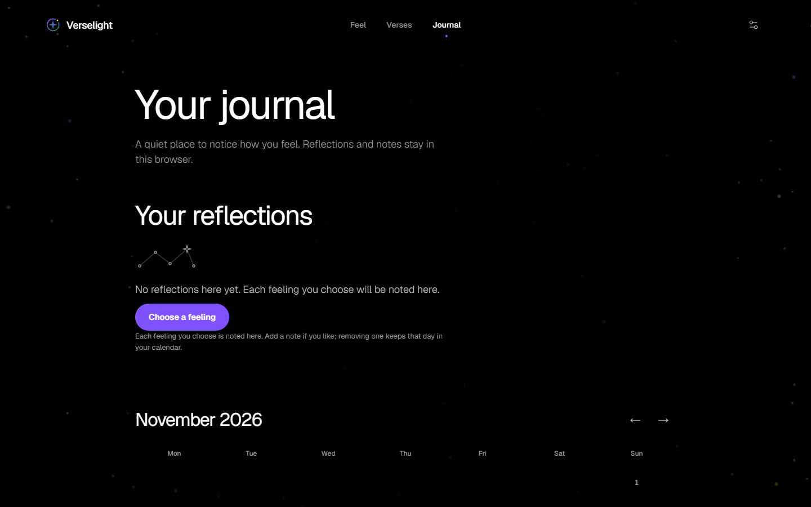

# Selah Sky

Emotion-based Scripture, reflection, and prayer for the feeling you bring today.

[](https://github.com/brentjoel/Verse/actions/workflows/ci.yml)  



**Live site:** https://verselight-app.vercel.app/

Built with Next.js 16, React 19, strict TypeScript, Tailwind CSS 4, Three.js and Playwright, deployed on Vercel. Lighthouse 90+ in every category is a CI gate.

## Features

- **Constellation wheel:** thousands of WebGL particles form eight emotion clouds. Drag, scroll, use arrow keys or tap a chip; the center opens an inner ring of feelings in that emotion's color. A server-rendered List view covers no-JavaScript, no-WebGL, reduced-motion and slow devices.
- **Verse first:** the passage, its attribution and the pager fit the first phone screen, with a small particle dawn in the emotion's hue. Tap to finish the reveal.
- **Five translations:** NLT, KJV, WEB, ASV and BSB, with live side-by-side comparison.
- **Private by design:** saved verses, collections and a mood journal live in your browser, with local JSON backups and a one-tap Undo.
- **Companion:** an anchor verse, letters to your future self, seven-day paths, a prayer list, an optional journal passcode, a Year in light recap, a breathing guide and an on-device feeling finder.
- **Night, Daylight and Bedtime** themes, adjustable text size, offline reading of public-domain text, and WEB share cards through your phone's share sheet.



| Verse | Daylight | Phone | Journal |
| --- | --- | --- | --- |
|  |  |  |  |

[Full-quality demo video](docs/media/demo.webm) (turning the wheel to a verse). All captures use public-domain WEB text.

## How it is built

- **Next.js App Router** with Cache Components, strict TypeScript and Server Components by default.
- **Particle engine:** one `THREE.Points` draw call with a custom GLSL shader; rotation, selection, bloom and pointer glow are GPU uniforms. Quality tiers start from device hints and step down after a two-second frame-rate probe.
- **Design system:** a token-driven stylesheet (`app/styles/`), Night and Daylight palettes with contrast enforced by tests, and the system SF Pro stack on Apple devices.
- **Quality gates in CI:** unit tests (`node:test`), Playwright flows on phone and desktop, visual regression screenshots, and Lighthouse budgets of 90+ in every category.
- **Privacy:** no accounts, no analytics, no personal data on any server; share-card requests carry no cookies.

## Privacy and licensing

Everyone is a guest. Saved references, collections, journal notes and progress stay in the visitor's browser with unencrypted local JSON backups. There are no accounts, analytics or tracking. The translation preference cookie is the sole documented preference exception; hosting requests expose public page URLs and network metadata.

Strictly noncommercial, with no ads, payments, subscriptions, donations or paid features. NLT uses the official server-side Tyndale API with attribution and labeled WEB fallback, without persistent NLT text or NLT artwork. KJV, WEB, ASV and BSB use static public-domain sources, subject to KJV's special UK rights. NIV remains disabled pending licensed access.

See [translation terms](docs/TRANSLATION-LICENSES.md) and the [security audit](docs/SECURITY.md) for evidence and limitations.

## Run locally

Use Node.js 24 and npm:

```sh
npm ci
# Copy .env.example to .env.local and fill in values privately.
npm run dev
# Before opening a pull request, run everything GitHub checks:
npm run check
npm run e2e
```

Open http://localhost:3000. On PowerShell, use `npm.cmd` and `npx.cmd` if script launchers are blocked. Keep `NLT_API_KEY` server-only. Set `NEXT_PUBLIC_SITE_URL` to `https://verselight-app.vercel.app` as a stable HTTPS origin, then rebuild; do not hardcode the domain in application code. Never commit `.env.local`.

## Project documentation

- [Operations](docs/OPERATIONS.md): setup, checks, backups, NLT resilience, monitoring, Vercel verification and delivery workflow.
- [Product](PRODUCT.md), [architecture](docs/ARCHITECTURE.md) and [design](docs/DESIGN.md).
- [Progress](docs/PROGRESS.md): current state and roadmap.
